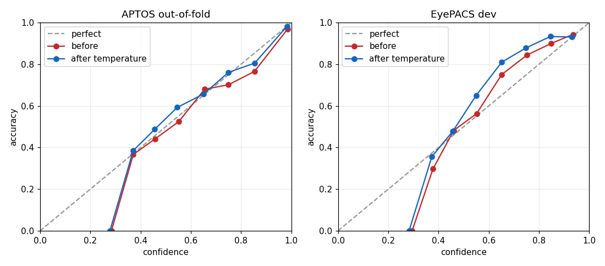

# Component: calibrated confidence and the "needs human review" rule

**In short:** the app can show a *calibrated* confidence and ask for a human review on difficult photos. The numbers below were chosen using only **cross-validation** data (APTOS out-of-fold predictions, OOF). EyePACS **dev** patients were used as an outside check (never to choose). **No test split was touched.** The values are proposals: **the team still has to choose** (see "Decisions needed").

All figures and tables: [`docs/figures/calibration/`](../figures/calibration/) (generated by [`src/evaluation/calibration.py`](../../src/evaluation/calibration.py)). Code used by the app: [`src/review.py`](../../src/review.py).

## 1. Calibration: temperature scaling
A model's confidence is calibrated when "80% confident" is right about 80% of the time. Temperature scaling divides the log-probabilities by a number T (T > 1 softens, T < 1 sharpens). The predicted grade never changes.

| Data | Method | ECE (smaller is better) |
|---|---|---|
| APTOS OOF | raw | 0.030 (95% CI 0.024–0.045) |
| APTOS OOF | temperature, fitted on the other 4 folds (T ≈ 1.21) | **0.015** (0.014–0.032) |
| APTOS OOF | isotonic on the top-class confidence, cross-fitted | 0.016 |
| EyePACS dev (not used for fitting) | raw | **0.060** |
| EyePACS dev | temperature from APTOS OOF (T = 1.21) | 0.097 (worse) |
| EyePACS dev | temperature if it were fitted on dev (T = 0.92) | 0.045 (optimistic: dev would fit itself) |

**The finding to discuss:** on APTOS the model is slightly over-confident, so temperature 1.21 fixes it. On EyePACS dev, a population closer to real screening, the model is slightly *under*-confident, and the same temperature makes it **worse** (ECE 0.060 → 0.097). One temperature cannot serve both. Reason: the APTOS OOF comes from APTOS images, the deployed model mixes two sources, and calibration does not transfer between populations.

## 2. The sight-threatening alarm (threshold 0.028 on P(grade ≥ 3))
Frozen before the test at 90% specificity on EyePACS dev. Its cost:

| Population | Threshold | Sensitivity | Specificity | PPV | False alarms per 1,000 screened | Missed eyes |
|---|---|---|---|---|---|---|
| EyePACS dev (4.1% sight-threatening) | 0.0277 (frozen) | 0.931 | 0.900 | 0.285 | **96** | 10 of 145 |
| EyePACS dev | 0.10 | 0.848 | 0.948 | 0.413 | 50 | 22 of 145 |
| EyePACS dev | 0.20 | 0.766 | 0.970 | 0.526 | 28 | 34 of 145 |
| EyePACS dev | 0.30 | 0.697 | 0.979 | 0.591 | 20 | 44 of 145 |
| APTOS OOF (13% sight-threatening) | 0.0277 (frozen) | 0.966 | 0.726 | 0.347 | **238** | 13 of 377 |
| APTOS OOF | 0.10 | 0.923 | 0.819 | 0.434 | 158 | 29 of 377 |
| APTOS OOF | 0.20 | 0.881 | 0.873 | 0.511 | 110 | 45 of 377 |
| APTOS OOF | 0.30 | 0.841 | 0.907 | 0.577 | 81 | 60 of 377 |

Full tables (more operating points, raw and calibrated probabilities, referable flag): [`tables.md`](../figures/calibration/tables.md). Thresholds applied to calibrated probabilities are in the JSON output (`kaggle/runs/calibration.json`).

**What the over-sensitivity costs:** at the frozen threshold about 96 of 1,000 screened patients get a false "sight-threatening" alarm on EyePACS-like data (238 per 1,000 on an APTOS-like mix) while missing 10 of 145 such eyes. At 0.10 the false alarms halve (50 per 1,000) but 12 more sight-threatening eyes are missed. It is a screening trade-off, not a model error: lower the threshold to catch more, raise it to alarm less.

## 3. The "needs human review" rule (proposal)
A photo is marked for human review if any of these holds:
1. the top-class probability is below **0.50** (the model is unsure about the grade);
2. the referral decision is borderline: |P(grade ≥ 2) − 0.327| < **0.20**;
3. the quality gate says **Usable**.

Chosen on APTOS OOF (a small grid over rules 1 and 2; the smallest missed-referable among ~87% automatic). What it does:

| Data | Share kept automatic | Grade error, all photos | Grade error, automatic only | Missed referable eyes (model says "refer" = no): total → left automatic (reviewed) |
|---|---|---|---|---|
| APTOS OOF | 87% | 17.5% | 12.1% | 86 → 31 (55 caught by review) |
| EyePACS dev (not used to choose) | 74% | 25.9% | 18.7% | 176 → 78 (98 caught by review) |

Review is asked for on 13% of APTOS OOF photos and 26% of the EyePACS dev photos. It catches the uncertain cases but not all errors: confident mistakes stay automatic. Sight-threatening eyes: on dev, 7 of the 10 the flag misses are still automatic, because a confidently wrong photo is not borderline.

**Extra cost/benefit table** for different automatic shares is in [`tables.md`](../figures/calibration/tables.md) (columns: share, grade error, missed referable left automatic).

## Decisions needed from the team (proposals are only defaults)
1. **Calibrated confidence in the app:** (a) use T = 1.21 (as the plan asked, fitted on APTOS; it makes EyePACS-like confidence less accurate), (b) show the raw confidence, or (c) choose a temperature after collecting more data from the target population. Recommendation: **(b) or (c)**; the code uses 1.21 as default only so the app follows the plan, and it is one environment variable (`RG_TEMPERATURE`) away from raw.
2. **Sight-threatening threshold:** keep 0.028 (frozen and tested), or move to 0.10–0.20 (about half the false alarms or fewer; 12–24 more missed eyes on dev). Any change must be declared as made after the test.
3. **Review rule:** accept the proposed rule, or ask for a stricter one (e.g. margin 0.25 → about 85% automatic) or a looser one.

## Why this design
- **Simple quantities** (top-class probability, distance to the referral threshold, quality label): a clinician understands them and they need no extra model.
- **Calibration changes only the displayed confidence.** Flags, grade and the review rule use raw probabilities, so a later calibration decision never changes what was tested.
- **Chosen on cross-validation, checked on another population**, because a rule that looks good on the data it was tuned on is worthless.

## Five examiner questions
1. **Why calibrate if the grade does not change?** People act on the confidence number ("the model is 90% sure"). If it overstates certainty, they over-trust the model.
2. **Why did calibration get worse on EyePACS?** The temperature was fitted on APTOS, where the model was over-confident; EyePACS dev has the opposite tendency. Calibration learned on one population does not transfer automatically.
3. **What does the 0.028 sight-threatening threshold mean?** It means the model flags an eye as sight-threatening when it gives severe/proliferative disease at least 2.8% probability. It was chosen to give 90% specificity on EyePACS dev, so it is deliberately sensitive; the table shows the price in false alarms.
4. **Does the review rule make the system safer?** It moves the uncertain photos to a person (it keeps 87% of photos automatic and cuts the automatic grade errors from 17.5% to 12.1% on APTOS). But confident mistakes remain, so it reduces, not removes, risk.
5. **Why not choose the rule on the test set?** The test was used once for the final measurement. Tuning on it would make the reported test results optimistic.
